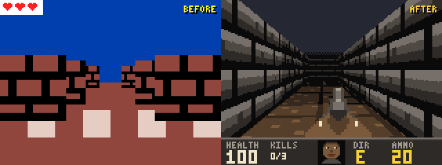
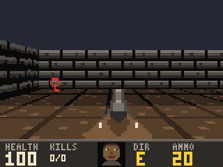
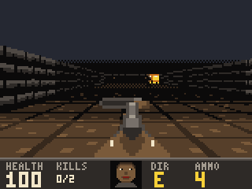
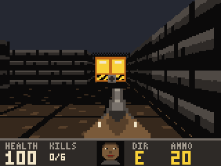
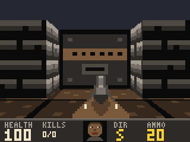
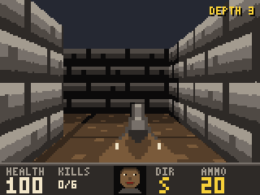
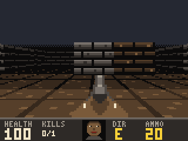
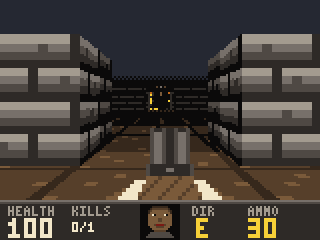
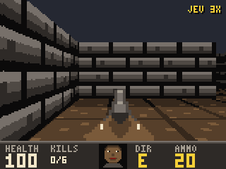

# Corridor

A Doom-style raycaster for MakeCode Arcade consoles on the STM32F401 (tested on the ELECFREAKS Retro
Arcade: 160×120 screen, 84 MHz Cortex-M4, 96 KB RAM). Written in MakeCode Static TypeScript with
fixed-point math, no floats in the hot loop.



| | |
|---|---|
|  |  |
|  |  |
|  |  |
|  |  |

## What is in it

- **Campaign** of three hand-made levels: hangar, warehouse, arena with a boss. Red and blue keys,
  sliding doors, secret walls, level summary (kills, items, secrets, time) and a Doom-style melt between
  screens. **Levels** on the title screen starts the campaign from any of the three; starting past
  the warehouse hands over its shotgun. Only a full run from the hangar sets a time record.
- **Endless mode**: depth N is a 24×24 maze generated from seed N, with rooms, keyed doors placed on
  the only way to the exit (the key is always on your side of its door), lava, and more and tougher
  enemies the deeper you go. A boss guards every fifth depth.
- **Enemies**: imp, fireball shooter that keeps its distance, fast knight, boss with a fan of
  fireballs. Death animations, blood and scorch decals, growls from behind corners.
- **Weapons**: pistol and shotgun (spread, damage falls off with range).
- **Rendering**: textured walls, doors and floor, per-cell light with flickering lamps, lava, sprites
  sorted against a z-buffer, automap. A quality ladder steps down (floor 2×2 → floor bands → 80 rays)
  after 3 s below 20 FPS.
- **Feel**: distance-attenuated sound, music, pause menu, difficulty (easy / normal / hard), records
  saved on the console.
- **AI player**: `PLAYER AI` on the title screen hands the controls to Jev, a fast decision model,
  running on a Mac connected over USB. See below.

## Controls

| Button | Action |
|---|---|
| D-pad | Walk and turn |
| A | Fire, open doors |
| B + left/right | Strafe |
| B tap | Automap |
| B double tap | Switch weapon |
| B hold | Pause menu (music, difficulty, quit) |
| Menu | System menu of the console |

## Build and flash

```bash
npm ci
npm test               # unit and feature tests in Node (logic, render, pilot playthroughs)
npx makecode build     # -> built/stm32f401/binary.uf2
npm run demo           # re-renders demo/out/*.gif from scripted runs of the real game code
```

Prebuilt `corridor.uf2` is attached to each [release](https://github.com/romzes5000/retro-corridor/releases).
To flash: connect the console over USB, double-press Reset until the `ARCADE-F4` drive appears, copy
the UF2 onto it. The console reboots into the game.

The game logs `fps N qQ step S` to the console once every 5 s (readable over HF2), handy for checking
performance on real hardware.

## AI player over USB (Jev)

With `PLAYER AI` selected, the console plays by itself while a bridge on the computer decides what to
do next. The game never waits for it: it keeps running at full speed and executes the last command.

1. Every 250 ms the console prints a snapshot over the HF2 serial channel: player, live enemies,
   fireballs, doors, picked-up items (`AI S ...` to `AI END`). The map never goes over the wire.
2. The bridge rebuilds the same level from the game code (`load-logic.ts`) and checks the console's
   map hash, then works out the route (key, its door, the exit, or the boss while the exit is locked).
3. It describes the situation in plain English and asks Jev (TypeSafe System One,
   `/api/v1/systemone` on OpenRouter) to pick one tactic: advance, attack, dodge left or right,
   retreat, heal, ammo, weapon (go for the shotgun), open, wait. The facts: goal, health state,
   weapon, enemies in sight (and whether they can bite), enemies seen in the last 5 s, the safe side
   of an incoming fireball, medkit, ammo and shotgun with the detour each costs, nearby lava, the
   outcome of the last commands. Only what the player can see counts: no enemies through walls; a
   boss out of sight is looked for where it was last seen, then where it appears. The facts
   describe the moment the answer will land: the bridge runs its copy of the world forward by the
   usual Jev latency under the command already playing.
4. The tactic becomes one short command (walk a route of up to 3 straight legs, attack enemy N,
   backpedal from it while shooting, strafe, use, wait), written straight into a 32-byte mailbox in
   the console's RAM. Commands answering a snapshot older than 1.2 s of game time are dropped.

The console follows the route from the cell the bridge planned from, turns into the next leg before
reaching the corner, and on its own shoots whatever is under the crosshair and sidesteps a fireball
landing within 300 ms. It never steps into lava. If the player stands still out of combat for 6 s,
the bridge overrides Jev's pick with advance once.

The screen shows `JEV ATTACK 84% 230MS` (tactic, confidence, model latency), red when Jev says
danger is high, or `NO LINK - RUN NPM RUN AI` after 3 s without commands. A on `PLAYER` in the
title menu toggles between you and AI. AI runs never set records; after a death the level restarts
by itself, after a win the next one starts. Hold B for the pause menu, `QUIT` returns control to you.

```bash
export OPENROUTER_KEY=...            # an OpenRouter API key; never commit it
npm run ai -- --check                # console only: finds the mailbox, listens for 3 s
npm run ai                           # play on the console (pick PLAYER AI, start a level)
npm run ai -- --sim HANGAR --runs 5  # same protocol against the game running in Node
npm run ai -- --sim ALL --runs 5 --quiet   # bench: every campaign level, wins, idle time, damage
npm run ai -- --sim HANGAR --fake --fast --lag 500   # rule-based picks, no key, virtual time
npm run ai -- --sim ARENA --runs 10 --attempts 4 --quiet --lessons   # deaths before the win
npm run ai -- --sim D1-D5 --difficulty easy   # endless depths 1 to 5
npm run ai:eval                      # 10 fixed situations x 5 Jev calls, hit rate per situation
npm run ai:probe                     # latency and cost of 30 Jev calls
npm run ai:probe -- --variants       # latency of action only / action + danger / trimmed state
```

`--no-reflexes` turns off the console reflexes and `--no-predict` the forward run of the facts, to
measure what each adds.

To film AI play on the console, add `--film`: the bridge writes every snapshot and decision to
`bridge/out/film-*.jsonl`, and `npm run ai:film -- bridge/out/film-X.jsonl` renders it with the
game's own renderer into an MP4 (640x480, needs ffmpeg) or, with `--out clip.gif`, a GIF;
`--speed 2` plays it twice as fast. This is a reconstruction from 4 snapshots per second: motion in
between is interpolated, and shots, hits, kills and pickups are inferred from what changed.

To watch live, add `--watch` and open `http://localhost:8787`. The bridge renders the same
reconstruction as the film as snapshots arrive, 300 ms behind the console (it needs the next
snapshot to interpolate towards), and streams 25 frames per second to the page. Next to the picture:
the level, health, weapon and kills, wins and deaths, Jev's decision count, latency and cost, how often
the forced heal, the watchdog and a lesson stepped in, the console fps, the lessons (those of the
current level first, the one in force highlighted) and a feed of Jev's decisions with deaths, wins,
new lessons and overrides in colour. `NO SIGNAL` means no snapshot for 1.5 s. `--watch-port` changes the port;
`--watch-host 0.0.0.0` opens it to the local network, for a phone. Works with `--sim` too.

### Lessons after a death

Jev answers one situation at a time and remembers nothing, so after a death the bridge writes down
what went wrong. It keeps the last 15 s of damage, heals and its own picks, takes the streak of hits
that ended in the death (back to the last heal or a 3 s pause), and sends it to a second model
(`openai/gpt-4.1-mini` on OpenRouter, a strict JSON schema). The answer is a lesson: conditions from
a fixed list (a biter in reach, a shooter or the boss in sight, a fireball close, health below 60 or
40), one action (attack, retreat, dodge, heal, weapon, ammo) and either a zone of the map or none.
A zone lesson holds on that map only, up to 3 per level; a global one holds everywhere, endless
depths included, up to 3 in total. If the model is down or answers nonsense, a rule writes the lesson
from the cause of death; lava deaths teach nothing, the console already refuses to step into lava.

When a lesson's conditions hold and its action makes sense right now (a medkit to go to, a fireball
to dodge, an enemy to fight), the state gets a `lesson` field and Jev's criterion for that action
gets "this is what lesson says to do". If Jev still picks a calm move (advance, wait, open, ammo,
weapon), the lesson's action replaces it and the label gets a `!`: `HEAL!`. The stall watchdog and
the forced heal below 40 HP come first. A lesson that was in force when the same death repeats
counts as failed and is dropped after two failures; one in force on a won attempt counts a win, and
the weakest lesson goes when a group is full.

Lessons are off by default; `--lessons` turns them on. They live in
`bridge/out/lessons-console.json` and `lessons-sim.json` and survive restarts; `--lessons-file FILE`
picks another file and `--lessons-reset` starts from empty (either one implies `--lessons`).
`--attempts N` lets a simulated run retry after a death up to N attempts and reports the deaths
before the first win. `LESSON_MODEL` overrides the reflecting model.

They do not pay off yet. Ten simulated runs per level on normal, up to 4 attempts each, lessons
starting from an empty file:

| Level | Lessons | Won within 4 attempts | Deaths before the win |
|---|---|---|---|
| ARENA | on | 4/10 | 30 |
| ARENA | off | 3/10 | 34 |
| WAREHOUSE | on | 10/10 | 0 |
| WAREHOUSE | off | 9/10 | 5 |

The ARENA gap is within run-to-run noise, and on WAREHOUSE the lessons run never died, so no
lesson was ever in force there. A lesson was in force for 175 ARENA decisions, yet it never had to
replace Jev's pick: in those moments Jev already fought or dodged. The model wrote 30 lessons, one per
death, and most were tied to a small zone and to health under 40, so a new attempt rarely met the same
conditions again. Endless depths 1 to 5 on easy, two passes, were won on the first attempt with or without
lessons, except one death on D5 in the first pass of each, so the global lessons had nothing to show
there.

`JEV_MODEL` overrides the model (default `~typesafe/jev-latest`). Every decision goes to
`bridge/out/run-*.jsonl` with the facts, the answer, the latency and the cost.

On five simulated runs of the hangar on normal Jev won 5 of 5, at 488 ms median latency
(591 ms p95), about 2 decisions per second and $0.00003 per decision, roughly $0.03 for ten minutes
of play. The GIF above is one of those runs replayed from `demo/ai-hangar.json` at 3x.

## Layout

| File | What |
|---|---|
| `logic.ts` | World, ray casting, movement, combat, input gestures |
| `doors.ts`, `enemies.ts` | Doors and keys; enemy kinds, AI, fireballs |
| `levels.ts`, `procgen.ts` | Campaign maps; endless-mode generator |
| `game.ts` | Sessions, menus, difficulty, records |
| `render.ts`, `art.ts` | Renderer; walls, weapons, items and font drawn in code |
| `art-enemies.ts` | Enemy and fireball frames, generated from `art-src/demons.png` |
| `tools/` | Sprite sheet importer |
| `ai.ts` | AI link on the console: snapshots, mailbox, route follower, reflexes, status line |
| `main.ts` | Device glue: loop, sound, music, settings, AI mailbox |
| `bridge/` | AI bridge on the computer: HF2 transport, shadow world, route, memory of what was seen, facts, Jev, simulator, eval situations |
| `demo/` | Pilot bot, GIF recorder, legacy renderer for the before/after clip |

## Art

Walls, weapons, items, HUD and font are hex strings in `art.ts`, drawn by hand in the 16-colour palette.

Enemies come from a sprite sheet, `art-src/demons.png`: imp, shooter, knight and boss, eight frames each
(walk A, walk B, attack, hurt, three death frames, corpse), plus two fireball frames.
`npm run sprites` turns it into `art-enemies.ts`:

- cell boxes are a fixed table in `tools/sprite-import.ts`; `demo/out/sheet-cells.png` draws them over the
  sheet for checking;
- the background is removed by a flood fill from the cell edges;
- every pixel is snapped to the game palette first (each kind has its own colour set), then the cell is
  shrunk to 16x16 (boss 24x24, fireball 8x8) with one scale per kind, anchored at the bottom centre;
- `OVERRIDES` patches single pixels after the import;
- `demo/out/sheet-enemies.png` is a preview of the result.

Do not edit `art-enemies.ts` by hand: change the sheet or the importer and run `npm run sprites` again.

## Disclaimer

Corridor is a fan homage to the 1993 game DOOM. It is not affiliated with, endorsed by or connected
to id Software, ZeniMax or Bethesda. DOOM is a trademark of id Software LLC. No code, graphics, sounds
or levels from DOOM are used: all art, maps and music in this repository are original.
The enemy sprite sheet was generated by a neural network from our own prompt; it contains no DOOM assets.

## License

[MIT](LICENSE)
